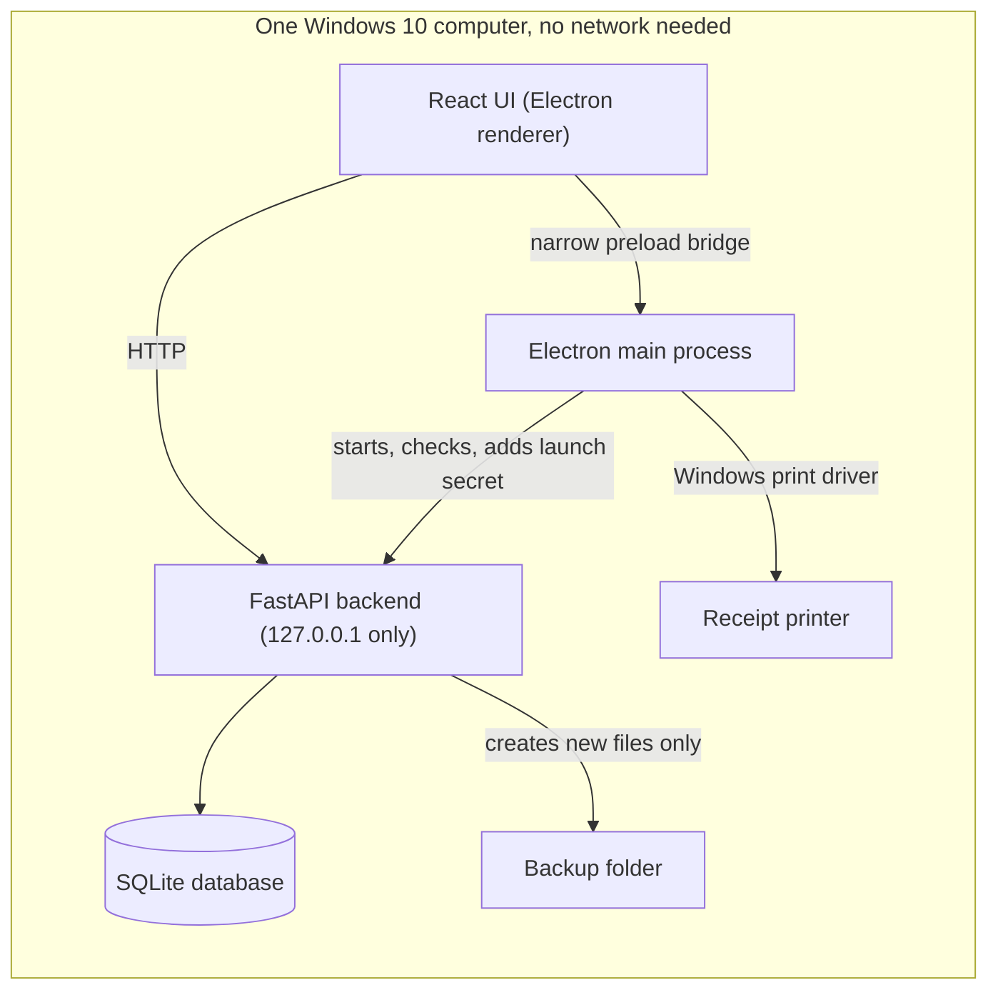
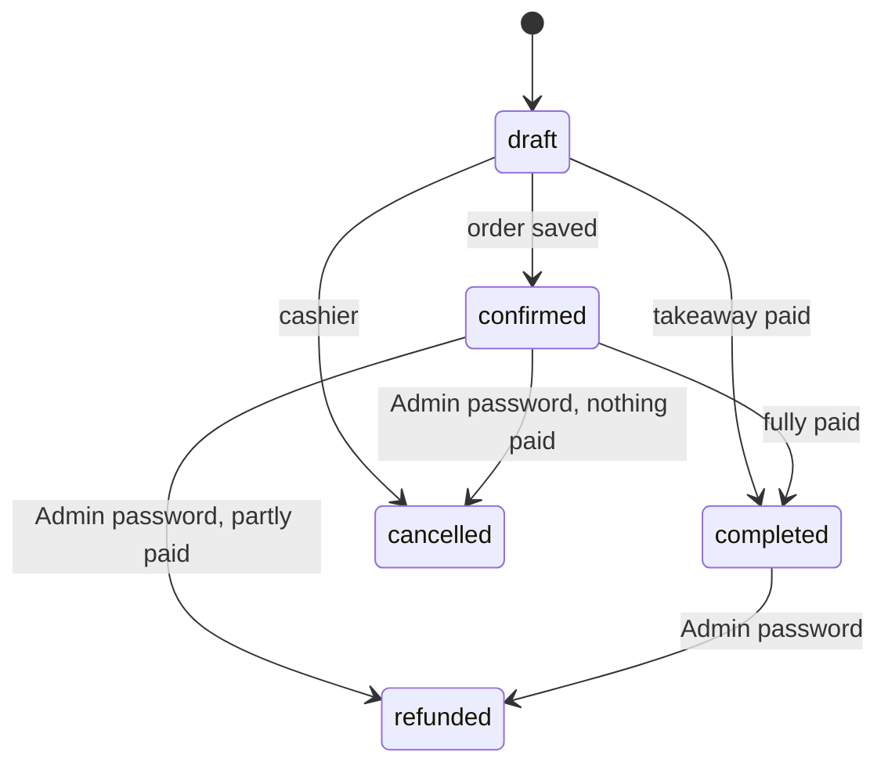
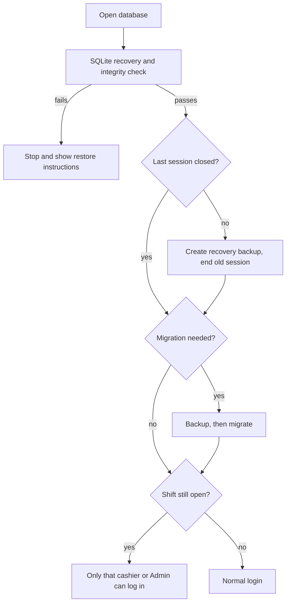

# Gyros POS: System Design Architecture

**Status:** Draft for owner review. Nothing here is implemented yet.
**Sources:** [PROJECT_REPORT.md](PROJECT_REPORT.md) ("the spec"; § numbers refer to it) and the owner's answers of 23 November 2026. Where they differ, the owner's answers win.
**Companion:** [BUILDING_PLAN.md](BUILDING_PLAN.md)

## 1. Decisions

### 1.1 Confirmed by the owner

| ID | Decision | Effect on the spec |
|---|---|---|
| D1 | Menu prices are in LBP. LBP is authoritative; changing the rate never changes LBP prices | Overrides the USD-based example in §6.3 |
| D2 | Each product has one name, in either language | Clarifies §5 |
| D3 | USD equivalents are shown to the cent | Clarifies §6 |
| D4 | Discounted totals and LBP change round to 10,000 LBP | Clarifies §6 |
| D5 | Cash only, in USD, LBP or both. No VAT or service charge | Clarifies §6 |
| D6 | Cashier chooses the change currency or combination | Resolves §6.3 |
| D7 | Promo codes: percentage, one per order, optional dates and total usage limit. The discount includes the delivery fee | Resolves §7 |
| D8 | Delivery is prepaid, or left unpaid until the driver returns | Adds to §9 |
| D9 | A table cannot close with money owed unless Admin overrides. An unpaid bill can be printed | Adds to §10 |
| D10 | Cashiers cancel drafts. Saved table items, saved orders and refunds need the Admin password and a reason | Adds to §4 |
| D11 | Logout ends the shift and requires the cashier's own password. The Admin password can close an abandoned shift | Adds to §3 |
| D12 | Open tables and unpaid deliveries pass to the next shift. A payment belongs to the shift that takes it | Adds to §3.4 |
| D13 | After a crash: recovery backup, then the same cashier resumes. Admin can close the old shift | Resolves §15.3 |
| D14 | Cash-count method is an Admin setting: totals, by banknote, or closing only with a fixed opening amount | Resolves §3.4 |
| D15 | Cashiers look up current-shift orders by number. Reprints say "COPY" | Resolves §24 |
| D16 | Admin sets the business-day cutoff. Order numbers restart each business day | Adds to §12 |
| D17 | Receipts are Arabic only. The application stays Arabic and English | Overrides §11.1 and the English-receipt test in §21 |
| D18 | Inventory and expenses are in the first release, and remain optional to use | Sets the scope of §13 |
| D19 | Stock is changed manually by Admin. Sales never change it. Warnings never block a sale | Resolves §13.1 |
| D20 | Only Admin logs expenses and costs. They never affect a shift or drawer | Resolves §13.2 |
| D21 | Sales is the main number. Profit carries the note "only from what you logged as expenses and costs" | Resolves §12.3 |
| D22 | Forgotten Admin password: recovery key, replaced after use | Adds to §3 |
| D23 | Restore is an Admin screen: verify, back up current data, then restore | Resolves §15.4 |
| D24 | Electron + React + Python/FastAPI + SQLite | Confirms §17 |
| D25 | No cash-drawer link | Clarifies §11 |
| D27 | During a cashier's shift, the Admin password can open a short, audited Admin screen for menu availability and the exchange rate only. The shift stays open | Adds to §3 |
| D28 | The owner accepts that someone using the same Windows account could read the database file. Windows option A is used (section 10) | Resolves the identity question in §15.2 |
| D29 | One installer, with no dependencies to download or install by hand. Docker on the POS computer is not required, so it is not used | Confirms §17 and §21 |
| D30 | Build for 32-bit Windows 10, which also runs on 64-bit. A 64-bit version is shipped later if the PC allows it | Sets §17 packaging |
| D31 | Order lookup needs a short random receipt code as well as the number | Adds to D15 |
| D32 | Admin can take orders, using their own shift | Clarifies §3.2 |
| D26 | Every finished step is committed and pushed to `main` with a descriptive message. Phase summaries in `HANDOFF.md` replace the approval stops (24 November 2026) | Process |
| D33 | [The screen design](design/Gyros_POS_Design.pdf) is approved. Takeaway is **استلام** and delivery is **دلفري** everywhere | Adds to §19 |
| D34 | Admin has a page that controls printer output, with a preview. The receipt code, paid/unpaid mark and copy mark cannot be hidden | Adds to §11.2 |
| D35 | An on-screen keyboard in the app's style opens for typing fields: numbers or letters (Arabic and English) by field. The physical keyboard keeps working | Adds to §19 |
| D36 | Cashiers pick their name from a list at login instead of typing it. The list contains active cashiers only | Adds to §3.1 |

### 1.2 Assumed, not confirmed

Used as defaults until the owner says otherwise.

| ID | Assumption |
|---|---|
| A3 | The owner can push to the GitHub repository |
| A20 | The wording in D33 applies to every Arabic label, including fees and receipts |
| A4 | Rounding is to the nearest 10,000, halves up. A discounted total never exceeds the undiscounted one |
| A5 | Undiscounted totals are not rounded |
| A6 | USD equivalents round **up** to the cent, so paying the displayed USD amount always settles the bill |
| A7 | After a table's bill is fully paid, new items start a new bill on the same sitting |
| A8 | Partial payments are allowed for dine-in and delivery, not takeaway |
| A9 | Refunds cover the whole order, not single items, and do not give back a promo use |
| A10 | Refunds pay out the LBP value at the current exchange rate, in any USD/LBP combination |
| A11 | An unpaid delivery prints its receipt at dispatch, marked unpaid. Taking payment later prints nothing unless asked |
| A12 | Admin logout also requires a password |
| A13 | Expenses and costs can be logged in LBP or USD |
| A14 | Cash-count choices in D14 are the meaning of "keep this as an option in the admin panel" |
| A15 | On totals of 10,000 LBP or more, a balance under 5,000 LBP after a payment counts as settled, because notes may not exist to pay it. The cashier confirms, and Admin sees the difference |
| A16 | Driver name is required when a delivery is dispatched, not when the order is started |
| A17 | Sales are dated when an order is fully paid, not when it is created |
| A18 | A cashier must open a shift right after login |
| A19 | A reprint shows USD at the rate of the order's last payment, or the current rate if unpaid |

### 1.3 Open

| ID | Question | Needed before |
|---|---|---|
| O1 | POS computer: CPU, RAM, disk, Windows edition. Architecture no longer blocks work (D30) | Finishing Phase 9 |
| O2 | Printer model, connection, paper width | Finishing Phase 6 |
| O3 | Windows PC for testing | Finishing Phases 6, 8 and 9 |
| O4 | Original logo file. Name, address, phone and footer come from the printed menu | Optional |
| O6 | Should backups be encrypted? They contain customer names, phones and addresses. A lost key makes them useless | Phase 8 |

## 2. System overview



| Part | Owns | Never does |
|---|---|---|
| React UI | Screens, input, Arabic/English display | Decide prices, totals, discounts, permissions or payment status |
| Electron main | Window, backend lifecycle, printing | Business rules, database access |
| Backend | All rules, permissions, transactions, reports, backups | Listen beyond loopback |
| SQLite | Durable state and constraints | Live on a network share |

It is a modular monolith: one backend process, one worker, one database file.

## 3. Repository layout

```text
backend/
  app/
    main.py            application factory and router registration
    core/              config, database, security, errors, logging, money, clock
    modules/<name>/    router.py, schemas.py, service.py, repository.py, models.py
  migrations/          Alembic
  tests/
frontend/src/
  app/                 routing, providers, layout
  features/<name>/     screens and API calls by feature
  shared/              UI components, API client, formatting
  i18n/                ar.json, en.json
desktop/               Electron main, preload, print window, packaging config
docs/
```

Modules: `auth`, `users`, `menu`, `orders`, `payments`, `promos`, `tables`, `delivery`, `shifts`, `receipts`, `reports`, `inventory`, `expenses`, `backups`, `settings`, `audit`. A module only has the files it needs.

- Routers validate input and call one service. Services own transactions and permission checks. Repositories only query.
- A module calls another module's service, never its repository.
- `core/money.py` is the only place that converts or rounds money.

## 4. Money

All amounts are integers: LBP in whole pounds, USD in cents, rate in whole LBP per USD. Floating point is never used for money.

| Operation | Rule |
|---|---|
| USD to LBP | `cents × rate ÷ 100`, halves up |
| LBP to displayed USD | `ceil(lbp × 100 ÷ rate)` cents (A6) |
| Gross | items + delivery fee |
| Discount | `gross × percent ÷ 100`, whole LBP, halves up |
| Total, no promo | gross, not rounded (A5) |
| Total, with promo | `min(round_10000(gross − discount), gross)` |
| Order rounding | total − (gross − discount), stored |
| Overpayment | LBP value received − balance due |
| LBP change | `round_10000(overpayment − LBP value of USD change)` |
| Change rounding | overpayment − LBP value of all change, stored |
| Small balance | if total ≥ 10,000 and a payment leaves less than 5,000 due, settle it and store the shortfall (A15) |

USD change cannot be worth more than the overpayment. Stored rounding amounts let every shift reconcile exactly. Each order stores its item prices and each payment stores its own rate, so an open table paid across a rate change stays correct.

Worked example, rate 89,500, gross 455,000, 10% promo:
- Discount is 45,500, leaving 409,500. Total is 410,000 and order rounding is +500.
- Displayed USD is `ceil(410,000 × 100 ÷ 89,500)` cents = $4.59.
- Customer gives $5.00, worth 447,500. Overpayment is 37,500.
- All-LBP change is 40,000. Change rounding is −2,500.

## 5. Order and payment model

### 5.1 States

Order lifecycle and payment state are separate.



Payment state (`unpaid`, `partial`, `paid`, `refunded`) is derived from committed payments and never set by the UI.

- Every draft change is autosaved. Items are `draft`, `confirmed` or `voided`.
- Confirmed items are never deleted. Voiding one needs Admin approval and is rejected if the total would fall below the amount already paid.
- A promo is validated when entered and again in the payment transaction, where its use is counted. An order paid in parts counts once.
- Cancelling or refunding never deletes records.

### 5.2 Dine-in

A `table_sitting` is open from the first saved order until a cashier closes the table. It holds one or more bills (orders), with at most one unpaid at a time. Paid bills cannot change. Payment never closes the sitting. Reducing the table count is refused while a removed table is open.

### 5.3 Delivery

Customer name, phone, address and fee are required; driver name is required at dispatch (A16). Requested and promised times are optional. The default fee is copied to the order and can be changed there only. Driver is a text field that suggests earlier names. The cashier's unpaid-delivery list shows what each order owes and no combined total.

### 5.4 Payment transaction

The client creates an idempotency key when the payment screen opens. In one `BEGIN IMMEDIATE` transaction the backend:

1. Returns the stored result if the key was already used with the same body; rejects a different body with 409.
2. Checks the session, open shift, order version and state.
3. Recalculates the total and revalidates the promo.
4. Checks the received amounts and proposed change.
5. Writes the payment, its cash lines, promo use and print job.
6. Marks the order completed only if it is fully paid, then commits.

The UI says "paid" only after the commit response. On timeout it retries with the same key. Printing happens after commit and cannot undo a payment.

## 6. Data model

UUID primary keys. Times are UTC, with `business_date` fixed when the record is confirmed, so changing the cutoff never rewrites history.

| Table | Key contents and constraints |
|---|---|
| `users` | username (unique), role, Argon2id hash, active |
| `recovery_keys` | Argon2id hash, used_at |
| `sessions` | user, shift, token hash, start, end, end reason; at most one active |
| `shifts` | user, count mode snapshot, opening amounts, status; at most one open |
| `shift_closings` | shift (unique), declared and expected USD/LBP, banknote detail, reference (unique), closed_by |
| `categories`, `products` | name, `price_lbp > 0`, available, archived_at |
| `orders` | type, number + business_date (unique), receipt code, state, version, snapshots of gross/discount/rounding/total, creator, shift |
| `order_items` | product, name and price snapshot, quantity > 0, note, state |
| `dining_tables`, `table_sittings` | open and close user/time; one open sitting per table |
| `delivery_details` | customer, address, fee, driver, optional times |
| `payments` | order, kind (payment/refund), idempotency key (unique), request hash, rate, applied LBP, change rounding, shortfall, user, shift, business_date |
| `payment_lines` | payment, currency, direction (in/out), amount > 0 |
| `promo_codes`, `promo_redemptions` | percent 1–100, dates, limit; one redemption per order |
| `exchange_rates` | rate, set_by, set_at; append-only |
| `print_jobs` | order, kind, state, attempts, error, copy flag |
| `inventory_items`, `stock_movements` | optional product link, quantity, threshold, reason, user |
| `expenses` | kind (expense/cost), category, amount, currency, rate, date, user |
| `settings` | typed key/value |
| `audit_log` | actor, approver, action, target, before/after, time; database triggers block update and delete |
| `backup_records` | session, kind, filename, SHA-256, status, error |

Products and categories with history are archived instead of deleted. Payments, lines and closings are append-only.

## 7. Security and permissions

**Local API**
- Binds to `127.0.0.1` on a random port.
- Electron main generates a random secret at each launch, gives it to the backend and adds it to requests. The renderer never sees it. Requests without it are refused, which stops other programs and browser pages from casually using the API.
- Login returns a random session token, kept only in renderer memory and stored hashed.

**Electron:** context isolation and sandbox on, Node integration off, strict CSP, navigation and new windows blocked, single-instance lock.

**Login:** choose a role. Cashiers pick their name and enter a password; Admin enters username and password. Admin goes to the dashboard; a cashier must open a shift. Argon2id hashing and increasing delays after failures. The recovery key is shown once at setup and replaced after use.

**Admin approval:** the Admin password inside a cashier session authorises **one** named action on **one** target, checked by the backend, rate-limited and audited. The session stays the cashier's and gains no other rights.

**Quick Admin screen (D27):** the Admin password opens a short-lived grant limited to product availability and the exchange rate. It expires when closed or after 5 minutes, changes are audited under the Admin, and it gives no access to sales or any other Admin feature.

| Action | Cashier | Admin |
|---|---|---|
| Create orders, take payments, use tables | Yes, with a shift | Yes, with a shift (D32) |
| Cancel a draft | Yes | Yes |
| Void, cancel saved order, refund, close unpaid table | Admin approval | Yes |
| Look up and reprint | Current shift, number + code | All |
| Menu, rates, promos, users, settings | No | Yes |
| Reports, expenses, stock management, closing figures | No | Yes |
| Restore | No | Yes |

Cashier responses use their own schemas with no expected cash or sales aggregates. Every route is tested for both roles, and the test fails if a new route has no declared permission.

**Known limit:** someone with the same Windows account as the app may be able to open the database file directly, outside the POS. Application permissions cannot prevent this. The owner accepts it (D28).

## 8. Shifts

1. Cashier logs in and opens a shift using the configured count method.
2. Logout asks for their password and the closing count, then creates the closing record and a random reference.
3. The cashier sees the reference only. Admin sees expected, declared and difference for each currency.

Expected cash, per currency = opening + cash in − cash out. Expenses are excluded (D20), so cash taken from the drawer for an expense appears as a shortage.

The shift closes, the session ends, then the backup runs. A backup failure does not block logout; it is logged and shown to Admin. Closing an abandoned shift needs the Admin password and is recorded as an Admin closing.

## 9. Recovery, backup and restore

**Database:** foreign keys on, WAL journal, `synchronous=FULL`, explicit transactions, one writer.

**Startup**



**Creating a backup**
1. Take a consistent snapshot with SQLite's backup mechanism, not a file copy.
2. Compress it with gzip in the private data folder.
3. Create the final file in exclusive-create mode, write, flush and close it.
4. Reopen it read-only and verify its checksum.
5. Record its metadata.

Name: `pos_<UTC timestamp>_<session id>_<session|recovery|premigrate|prerestore>_<random>.db.gz`. If the name exists, creation fails and a new name is used. An interrupted write leaves a file that fails verification; the app cannot remove it and retries under a new name.

Every Admin or cashier session produces its own backup. There is no size limit.

**Restore:** Admin only, with no open shift and the Admin password re-entered. Verify gzip, integrity and schema version; refuse newer schemas; create a `prerestore` backup; swap the database while the backend is stopped; keep the old file until the restored one passes checks; migrate; return to login.

If the database is too damaged to log in, this screen is unreachable. The recovery guide must include a tested manual procedure for a Windows administrator.

## 10. Windows identity and backup protection

**Designed, not tested. No protection may be claimed until it passes on Windows.**

| | Option A: app writes directly | Option B: backend as a Windows service |
|---|---|---|
| How | Folder permissions allow creating and reading files, and deny deleting or changing them, including for the file's owner | Backend runs as its own restricted account, with the same folder permissions |
| Protects backups from the app | To be tested | To be tested |
| Hides the database from the cashier's Windows account | No | Yes, if tested |
| Complexity | Lower | Higher; the launch-secret exchange must change because Electron no longer starts the backend |

The app's user must be a standard Windows user, and only the elevated installer sets permissions. A Windows administrator can always override them; that is also how the owner manages backup files.

**Decision (D28):** option A. Option B is a fallback only if A fails the backup-protection test.

Test as the app's identity: creating succeeds; overwrite, append, rename, move, delete, permission change and ownership change all fail, on both new and older files.

## 11. Receipts and printing

- The backend produces receipt data. A hidden Electron window renders the Arabic RTL receipt and prints silently through the Windows driver. Chromium handles Arabic shaping, and the font is bundled.
- A `ReceiptPrinter` interface isolates this. ESC/POS is added only if the real printer needs it.
- 58 mm and 80 mm layouts. Delivery has its own layout.
- Product names print as entered.

A print job is created in the same transaction as the event that prints it and is claimed once, giving one automatic copy. States: `pending`, `printing`, `printed`, `failed`, `unknown`. A failed job can be retried as the original. If the app stopped mid-print the job is `unknown` and the cashier is asked. Any print after success is marked as a copy (`نسخة`).

## 12. Reports

| Metric | Definition |
|---|---|
| Sales (revenue) | Order totals, dated when fully paid, minus refunds of fully paid orders, dated when refunded. Includes delivery fees, also shown separately |
| Cash collected, by currency | Payment lines in minus out, dated when taken. Includes partial payments |
| Outstanding | Unpaid balance on confirmed orders |
| Product quantities, best and least sellers | Non-voided items on fully paid, unrefunded orders |
| Order count, sales over time, sales by order type | Same orders and dates as Sales |
| Cashier performance | Sales by the user who completed payment |
| Profit | Sales minus logged expenses and costs, always with the D21 note |

Sales and cash collected use different rules, so they are never added together or labelled as each other. Promo discounts cover items and the delivery fee, so product figures report quantity, not discounted revenue.

Filters: day, week (Monday–Sunday), month, overall, custom range, order type, product, cashier. Export to Excel and print, Admin only. The profit note appears on screen and in both outputs.

## 13. Menu import and export

`.xlsx` and `.csv` (UTF-8, Arabic-safe). Upload → validate → preview → Admin chooses add-only or add-and-update → apply in one transaction. Invalid rows are listed with row and reason, and nothing is written if applying fails. The preview is rejected if the menu changed after it was made. Likely duplicates use normalised names. File size, row count and unpacked size are limited. Exported text that looks like a formula is escaped, and the escape is reversed on import.

## 14. Interface and language

- Text comes from `ar.json` and `en.json`; a test fails if their keys differ.
- Layout uses logical CSS properties so one layout serves RTL and LTR. Fonts are bundled.
- Cashier screen: categories and large product buttons on one side, order summary on the other, payment in one step.
- Warnings never block or slow a sale.

## 15. Failure handling

| Failure | Result |
|---|---|
| Printer off | Order stays paid; print can be retried |
| Backend crash | Electron restarts it a limited number of times, then shows a clear error; user logs in again |
| Power cut | Startup flow in section 9 |
| Disk full | Transaction rolls back, clear error, nothing marked paid |
| Clock moved backward | Order numbers stay unique, using the next free number for the date; Admin is warned |
| Double click or retry | Same payment returned by its idempotency key |
| Backup folder missing | Logged and shown to Admin; sales continue |

Logs are local, rotating and structured. They exclude passwords, tokens, keys and customer details.

## 16. Limits

- Data that never reached the disk cannot be recovered.
- Stock warnings are only as accurate as Admin's last entry (D19).
- A backup on the same disk does not survive disk failure; the owner must copy files elsewhere.
- Windows administrators can bypass file permissions.
- No performance figure is claimed until measured on the POS computer.

## 17. Self-contained installation (D29)

One offline `GyrosPOS-Setup.exe` contains everything the app needs:

| Needed | How it is included |
|---|---|
| Browser engine, Node | Inside Electron |
| Python and its libraries | Inside the packaged backend (folder build, not a single self-extracting file) |
| SQLite, migrations | Inside the backend |
| Native runtime DLLs | Bundled; checked by the clean-machine test |
| Fonts, translations, receipt templates | Inside the app |

- Dependencies are locked to exact versions, so every build contains the same ones.
- The installer checks Windows version, architecture and disk space before changing anything, and explains any failure in Arabic and English.
- First launch checks that the backend starts and the data and backup folders are writable.
- The build fails if the packaged app makes a non-loopback network request during its smoke test.

Outside the installer: the printer's Windows driver, one administrator approval during installation, and possible Windows SmartScreen or antivirus warnings if the installer is unsigned.

Docker is optional for development only. On Windows it needs 64-bit, 8 GB RAM and virtualization according to its [installation page](https://docs.docker.com/desktop/setup/install/windows-install/), read on 23 November 2026, so it would add a dependency.

## 18. 32-bit build (D30)

Checked on 23 November 2026:

| Part | 32-bit Windows status |
|---|---|
| Electron | Published up to 43 (43.8.12 found); none for 44 or 45. Pin 43 |
| Python | 32-bit installers exist for 3.13 and 3.14. Pin 3.13 |
| pydantic-core, argon2-cffi-bindings, cffi, SQLAlchemy, MarkupSafe, PyInstaller | 32-bit packages published for Python 3.13 |
| greenlet | No 32-bit package. Use synchronous SQLAlchemy only, so it is not needed; the packaging trial confirms |

Electron's [breaking changes](https://www.electronjs.org/docs/latest/breaking-changes) say 32-bit support ends when version 43 reaches end of life in January 2027. After that the 32-bit build gets no Electron security fixes. The risk is reduced because the app loads no outside content, but not removed.

Only packaging may depend on architecture. Moving to 64-bit means a newer Electron, 64-bit Python and a rebuilt installer, with the same data format. The 64-bit installer must upgrade an existing 32-bit installation without losing data or backups.
